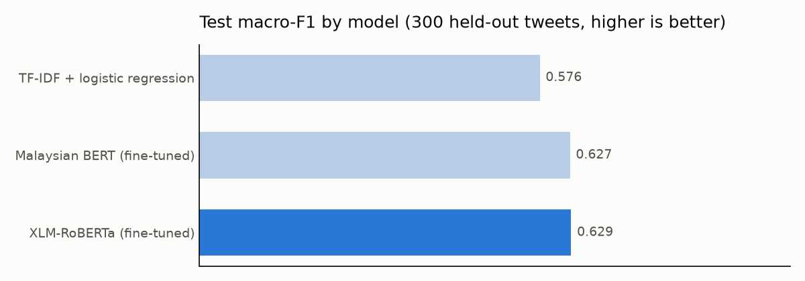
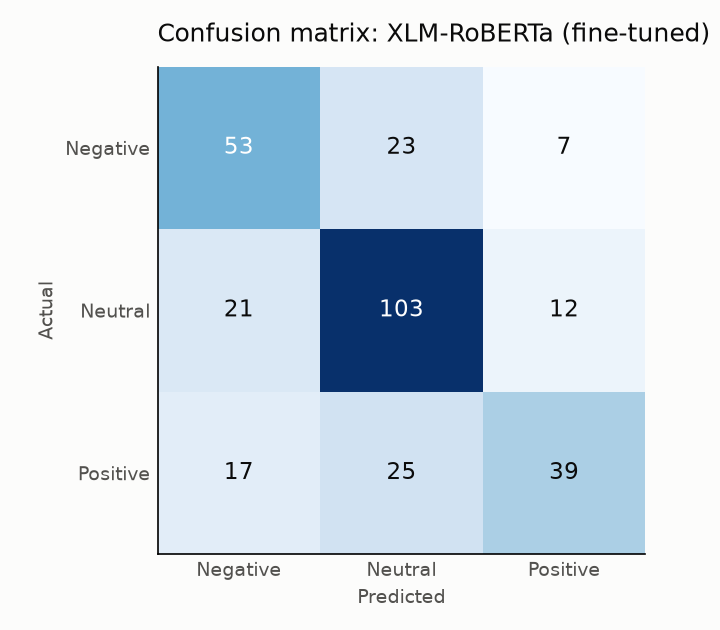

# Malay Tweet Sentiment Analysis Using BERT

Classifies Malaysian tweets (Malay, and Malay mixed with English) as **Negative**, **Neutral** or **Positive**.
It compares a classic TF-IDF baseline with two fine-tuned transformers, all trained on a CPU laptop.

**Model on Hugging Face:** [szal31/malay-tweet-sentiment-bert](https://huggingface.co/szal31/malay-tweet-sentiment-bert)



## Results

All three models use the same fixed split: 1,397 tweets for training, 300 for validation and 300 for test.
The validation split was used for every choice. The test split was scored once at the end.

| Model | Validation macro-F1 | Test macro-F1 | Test accuracy | Size |
|---|---|---|---|---|
| TF-IDF + logistic regression | 0.533 | 0.576 | 0.59 | < 5 MB |
| Malaysian BERT, fine-tuned (`mesolitica/bert-base-standard-bahasa-cased`) | 0.557 | **0.627** | **0.66** | 423 MB |
| XLM-RoBERTa, fine-tuned (`FacebookAI/xlm-roberta-base`) | **0.560** | **0.629** | 0.65 | 1.1 GB |

- **Fine-tuning beats the baseline by about 5 points** of macro-F1 (0.58 to 0.63).
- **The two transformers tie.** With only 300 test tweets, a 0.002 gap is noise.
- **The demo uses Malaysian BERT** because it gives the same accuracy at 2.5 times smaller size.

Macro-F1 is the main metric. It averages the F1 of the three classes equally, so a model can't score well by
mostly predicting Neutral, the largest class (45% of tweets).

## Where it goes wrong



The best model gets 105 of 300 test tweets wrong (all errors are in `output/errors.csv`). Reading them shows
three causes:

1. **Mixing up Positive and Neutral (25 errors) and Negative and Neutral (23).** Most mistakes involve the
   Neutral class rather than confusing Positive with Negative.
2. **Labels that are hard to agree on.** Some tweets have labels a human reader would argue with. For example,
   a tweet that is only a state name is labelled Positive, and a question about whether the lockdown will be
   extended is also labelled Positive. A model can't learn these reliably, which caps achievable accuracy.
3. **Sarcasm and Indonesian text.** "Semporna takpernah mengecewakan" ("Semporna never disappoints") is
   labelled Positive; the model reads it as Negative. The data also contains Indonesian news headlines, which
   use different vocabulary from Malaysian Malay.

**What would help most:** more labelled tweets and a second annotator to clean up disputed labels. With 1,400
training tweets, the data limits the score more than the model choice does.

## How it works

| Step | File | What it does |
|---|---|---|
| 1 | `prepare.py` | Cleans tweets (decodes `&amp;`, masks links as `URL` and usernames as `@USER`), removes duplicates created by masking and drops copies with conflicting labels, then makes a stratified 70/15/15 split with a fixed seed. |
| 2 | `baseline.py` | TF-IDF on word 1–2 grams plus character 2–5 grams (to cope with slang spellings such as *tak*, *x*, *takde*), then logistic regression. The regularisation strength is chosen on validation. |
| 3 | `finetune.py` | Fine-tunes a transformer with a plain PyTorch loop: AdamW, linear warm-up and decay, gradient clipping, and early stopping on validation macro-F1. The best epoch is saved and scored once on test. |
| 4 | `compare.py` | Builds the results table and charts, picks the best transformer by **validation** score, and writes its errors. |
| 5 | `demo/streamlit_app.py`, `app.py` | Web demos (Streamlit for the hosted version, Gradio locally). Both apply the same cleaning as training before predicting. |

**Running on a laptop without a GPU.** The first run used too much memory on a 12 GB laptop. Three changes fixed it:
- **Freezing the word-embedding layer.** XLM-RoBERTa's 250,000-word table alone needs about 3 GB to train, and
  with so few tweets it would barely change. The transformer layers and classifier still train.
- **Batch size 8, and inputs capped at 96 tokens.** Tweets are short, so the cap rarely cuts anything.
- **Saving the best epoch to disk** instead of keeping a second copy of the model in memory.

Each model trained in about 30 minutes.

## Run it

Uses Python 3.14.

```bash
python -m venv .venv
.venv\Scripts\activate
pip install -r requirements.txt
python prepare.py
python baseline.py
python finetune.py malay-bert
python finetune.py xlm-roberta
python compare.py
streamlit run demo/streamlit_app.py
```

The demo downloads the fine-tuned model from Hugging Face, so you can run it without training. Set `MODEL_PATH`
to use a local model folder instead. `python app.py` runs the same demo in Gradio.

## Data

[kornwtp/ms-bahasa-twitter-sentiment](https://huggingface.co/datasets/kornwtp/ms-bahasa-twitter-sentiment)
(Apache-2.0): 2,008 human-labelled Malaysian tweets. After cleaning and removing duplicates, 1,997 remain.
A much larger 3.2-million-row Malay sentiment set exists, but its labels were mostly produced by another model
and it has no licence, so it was not used.
